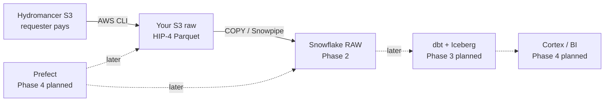

# Outcome analytics (s3out)

End-to-end analytics: **HIP-4 Reservoir → your S3 → Snowflake → (later) dbt / Iceberg / Prefect / Cortex.**

**Current focus:** Phase 1–2 only — landing and Snowflake raw load. **No modeling yet.**

→ **[plan.md](./plan.md)** — phased checklist and what’s deferred

## Phase 1–2 (now)

- [Reservoir → your S3](./how-to-reservoir-to-snowflake.md) (Hydromancer requester-pays; HIP-4 `outcome/all` only)
- [Connect Snowflake to your AWS bucket](./how-to-connect-snowflake-to-aws-s3.md) (storage integration + `COPY INTO` raw)
- [Copy one day with AWS CLI](./how-to-get-outcome-data-on-hyperliquid.md) — [Reservoir](https://docs.hydromancer.xyz/reservoir)

```text
Reservoir (requester pays)  ──AWS CLI──►  your S3 raw/global/fills/outcome/…
                                                │
                                                ▼
                                           Snowflake RAW  ← Phase 2 stops here
```

## Phase 3+ (planned, not started)

- dbt, Iceberg marts, venue filter, Prefect, Cortex — see [plan.md](./plan.md) and [future modeling notes](./how-to-model-iceberg-in-snowflake.md)

### Source bucket: `s3://hydromancer-reservoir` (requester pays)



