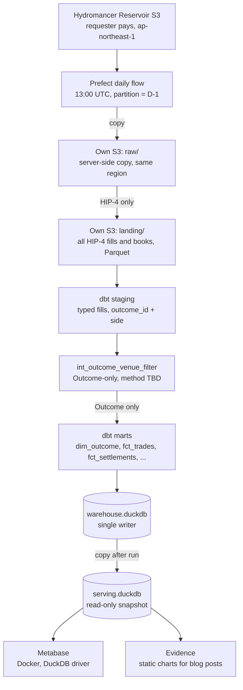

# Outcome Markets Historical Analytics — Project One-Pager

> **Execution path:** This repo’s active plan uses **Snowflake** (raw load now; dbt + Iceberg later). See [plan.md](./plan.md) and [README](./README.md). The stack table below includes the original DuckDB laptop option kept for blog comparison.

A learn-in-public data engineering project: daily historical analytics for Outcome's HIP-4 prediction markets on Hyperliquid, built only from the free Hydromancer Reservoir S3 archive (no API keys) with DuckDB, dbt, Prefect and Metabase.

## Goal and learning objectives

Build a reproducible, daily-refreshed analytics warehouse for markets deployed by the Outcome venue, and document every step as a blog series.

- Incremental ingestion from a requester-pays S3 bucket without surprise bills
- Lakehouse basics: raw, landing and modelled layers on your own S3
- dbt-duckdb modelling, tests and docs on a real, messy event dataset
- Prefect orchestration: daily partitions, retries, backfills, idempotency
- Self-hosted BI on DuckDB, and the single-writer constraint that comes with it
- Domain modelling for prediction markets: probabilities, settlement, PnL, calibration

## Outcome and HIP-4 in 60 seconds

- HIP-4 outcomes are fully collateralised contracts on HyperCore, priced 0–1 and settling to 0 or 1 (some templates to 0.5 or a scalar), with no leverage or liquidations.
- Each outcome has two side tokens. The side coin is `#<outcome_id><side>` (e.g. `#155630`), the balance token is `+<encoding>`, and the asset id is `100000000 + 10*id + side`.
- Questions group mutually exclusive outcomes plus a fallback; shares can be split, merged and negated.
- Outcome is a permissionless HIP-4 deployer venue and frontend: it instantiates validator-approved templates, sets the deployer fee scale and settles its markets on-chain, backed by a 500,000 HYPE slashable bond.
- Categories: sports, politics, macro, crypto, tradfi, culture. Price markets settle on HyperCore perp mark price TWAPs; event markets target resolution within 4 hours (Beta).
- Fees: Hyperliquid's standard schedule plus a settlement fee; Outcome's builder code fee is currently zero.

## Data sources

| Source | What | Access |
|---|---|---|
| `global/fills/outcome/all/date=D/fills.parquet` | All HIP-4 fills incl. settlement and split/merge/negate rows; extra `outcome_id`, `outcome_side`; from 2 May 2026, about 26 MB/day | Reservoir, requester pays |
| `by_dex/hyperliquid/orderbook/1m/outcome/date=D/#<enc>.parquet` | 1-minute top-20 L2 book per side, about 20 KB per file | Reservoir, requester pays |
| `global/candles/1s/date=D/candles.parquet` | 1s candles for all markets incl. HIP-4 (about 44 MB/day); usually cheaper to derive from fills | Reservoir, requester pays |
| `global/snapshots/spot/date=D/*.parquet` | Daily wallet token balances; may include `+<enc>` outcome tokens (unverified) | Reservoir, requester pays |
| `global/fills/outcome/builder_fills/date=D/fills.parquet` | HIP-4 fills that carry a builder address | Reservoir, requester pays |

No API keys: no Hydromancer API and no Hyperliquid info API. The documented Reservoir datasets have no market metadata: HIP-4 fills add only `outcome_id` and `outcome_side` to the standard fill columns, and no documented dataset holds registration or deploy actions. Reservoir is T+1: each UTC day lands the next day around 10:00–12:00 UTC.

## Filtering to Outcome only

> **Scope decided:** only markets with `venue = 'out'`. Validator-deployed markets with no venue, such as the recurring BTC/ETH/SOL/HYPE dailies and the World Cup markets, are excluded even though outcome.xyz can show them.

1. **Ingest all HIP-4 fills and books.** `global/fills/outcome/all` is about 26 MB/day, so land the whole set; no venue filter at load time.
2. **Derive the market key.** Confirmed on the 2026-10-21 file: `outcome_id = CAST(substr(coin, 2) AS BIGINT) // 10` on all 372,675 rows. The side column is `outcome_side`, with values `YES` and `NO`.
3. **TBD: filter fills to Outcome-deployed markets.** Method TBD by author. Lives in one dbt model, `int_outcome_venue_filter`, so it can change without touching the rest. The fill file has no `venue` column. On this day `dex` is `hyperliquid` for every row, so `dex` is not the venue.
4. **Build marts on the filtered set.** Every mart reads only outcomes that pass the filter.

Candidate signals noted during research, all untested:

- Outcome's builder address `0xab5dbc057628bc18523c4cdfc0e1e2ebdbecb704` in `builder` (outcome.xyz also lists other venues' markets, so it is not a venue signal on its own).
- Deployer addresses appearing in fills: `0x423d7f725ae7056f03f7ef57f9d0303f91c62e06` (Outcome docs) and `0x0c46eb73fae2816f219fcf11f50d6d3c59b5819e` (on-chain venue owner).
- `deployer_fee` on HIP-4 fills (documented for HIP-3 only).
- Outcome's [sitemap](https://outcome.xyz/sitemap.xml) lists market ids, but they include other venues' markets.

Trade-only metrics: `direction IN ('Buy','Sell') AND crossed`, which counts each match once. Confirmed `direction` values in this file: `Buy`, `Sell`, `Settlement`, `Split Outcome`, `Negate Outcome`, `Merge Outcome`, `Merge Question`. On 2026-10-21, Buy plus Sell is 347,588 rows and splits evenly into 173,794 taker rows and 173,794 resting rows.

## Stack options

| Layer | Options | Pick |
|---|---|---|
| Warehouse | Local DuckDB file · MotherDuck · DuckLake or Iceberg on S3 | Local DuckDB file |
| Ingestion | DuckDB httpfs straight from Reservoir (`REQUESTER_PAYS true`) · copy to own S3 first | Both: raw copy, then DuckDB reads own S3 |
| Transform | dbt-duckdb · SQLMesh | dbt-duckdb |
| Orchestration | Prefect · Dagster · cron + Make | Prefect |
| BI | Metabase + DuckDB driver · Evidence · Rill | Metabase, Evidence for the blog |

**Why this pick**

- Zero warehouse cost, runs on a laptop, simple to explain
- Own S3 landing copy makes reruns free of Reservoir fees and teaches lake layering
- dbt-duckdb external sources read Parquet on S3 directly
- Prefect is plain Python with a free local server
- Evidence makes static, linkable charts for blog posts

**Tradeoffs to write about**

- DuckDB is single-writer: a Metabase connection, even read-only, holds a lock that blocks dbt
- Metabase needs the community MotherDuck DuckDB driver, so self-hosted only (no Metabase Cloud)
- Use a read-only snapshot file mounted `:ro` in Docker for Metabase, refreshed after each dbt run
- MotherDuck removes the lock problem but adds a cloud dependency
- DuckLake on S3 is the stretch goal: newest piece, great blog topic, more moving parts

## Recommended architecture

Put the landing bucket in `ap-northeast-1` so the Reservoir copy stays in-region. The only credential is your own AWS read-only profile. Each task is idempotent per date and records what it loaded in a manifest table.

## Data model

| Model | Grain | Notes |
|---|---|---|
| `int_outcome_venue_filter` (TBD) | outcome_id | Outcome-deployed outcome ids; method TBD by author |
| `dim_outcome` | outcome_id | Outcome markets only: first and last trade, settlement price and date from fills |
| `fct_trades` | match (crossed side) | price as probability, size, notional, taker side, builder |
| `fct_fills_wallet` | fill per wallet | both sides, for wallet-level views |
| `fct_settlements` | outcome | `Settlement` fills: implied result per side from the settle price, payout and PnL |
| `fct_conversions` | conversion row | split, merge, negate |
| `fct_book_1m` | side × minute | best bid and ask, mid, spread, depth within 5c |
| `fct_wallet_positions` | wallet × side × day | running position from fills |
| `fct_wallet_pnl` | wallet × outcome | realised trading plus settlement PnL |
| `agg_market_daily` | outcome × day | volume, trades, unique traders, last price |

## Analytics questions

1. Calibration: do markets priced at 70% settle Yes about 70% of the time? Brier score by time-to-settlement.
2. Where is the volume: top markets, volume concentration, and growth over time.
3. Liquidity life-cycle: spread and depth from listing to expiry, and how thin books get near resolution.
4. Who wins: wallet PnL distribution, concentration of profits, makers vs takers.
5. Coherence: do the two sides' mids of each outcome sum to 1, and how big are the gaps?

## Milestones and blog series

1. **Post 1 — Mapping the data.** HIP-4 encoding, Reservoir layout, and the Outcome filter. Deliverable: notebook with one day of HIP-4 fills.
2. **Post 2 — Safe requester-pays ingestion.** IAM read-only user, budget alert, raw copy and landing filter, cost per day measured.
3. **Post 3 — Modelling with dbt-duckdb.** Staging, `int_outcome_venue_filter`, `dim_outcome`, `fct_trades`, tests for uniqueness and price range.
4. **Post 4 — Orchestrating with Prefect.** Daily partitions, retries, full backfill, late-arrival handling for T+1 data.
5. **Post 5 — Dashboards.** Metabase on DuckDB and the single-writer workaround; Evidence pages for public charts.
6. **Post 6 — Findings.** Calibration, liquidity and PnL results; optional DuckLake or MotherDuck migration.

## Cost and risk notes

- Requester pays: you pay S3 requests and egress. AWS gives 100 GB per month of free internet egress per account (per Hydromancer's guide); HIP-4 fills are about 26 MB/day, so the full history is a few GB (estimate).
- Avoid `global/fills/raw` (about 640 MB/day) and wide globs; check sizes with `head-object` first.
- DuckDB `REQUESTER_PAYS` on a `credential_chain` secret was reported unsupported in 2025 (httpfs issue #100); a `config` secret from an AWS profile is the fallback. Re-test on your DuckDB version.
- Latency is T+1, so the warehouse is historical by design; no intraday views.
- Every Outcome-only number depends on the venue filter; document its method in the posts once it is chosen.
- Without metadata there are no market names, templates, strikes or expiries; settlement is inferred from `Settlement` fills (price 1 or 0, per Hydromancer's docs).
- Confirmed by opening `global/fills/outcome/all/date=2026-10-21/fills.parquet` (372,675 rows, 573 `outcome_id` values): `outcome_side` is `YES` or `NO`, and the `direction` names above match the file. `outcome_id` is `UINTEGER`. Still unverified: distinct `asset_class` values, and whether spot snapshots include `+` tokens.
- Outcome is not available in some jurisdictions; keep the project read-only analytics.

## Open questions

1. Do you already have an AWS account and are you fine with the small requester-pays bill and a budget alert?
2. Is wallet-level analysis (PnL leaderboards of public addresses) in scope for public blog posts?

## Sources

- [Reservoir overview](https://docs.hydromancer.xyz/reservoir)
- [Reservoir fills schema](https://docs.hydromancer.xyz/reservoir/schema-reference/fills)
- [Reservoir orderbook schema](https://docs.hydromancer.xyz/reservoir/schema-reference/orderbook)
- [Reservoir snapshots schema](https://docs.hydromancer.xyz/reservoir/schema-reference/snapshots)
- [How to query Reservoir's Hyperliquid data](https://hydromancer.xyz/blog/exploring-reservoir)
- [HIP-4 outcome markets](https://hyperliquid.gitbook.io/hyperliquid-docs/hyperliquid-improvement-proposals-hips/hip-4-outcome-markets)
- [Outcome deployer architecture](https://docs.outcome.xyz/outcome-architecture)
- [Outcome resolution](https://docs.outcome.xyz/resolution)
- [Showcase Outcome markets (venue filter)](https://docs.outcome.xyz/sdk/guides/recipes/showcase-markets)
- [HIP-4 coin names and asset ids](https://docs.outcome.xyz/sdk/concepts/coin-naming)
- [Outcome builder codes](https://docs.outcome.xyz/builder-codes)
- [Metabase with DuckDB and MotherDuck](https://motherduck.com/docs/integrations/bi-tools/metabase/)
